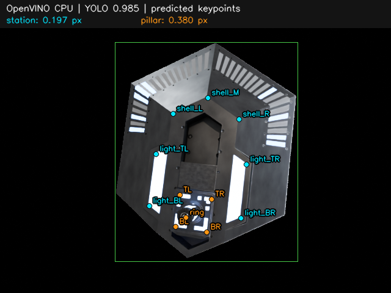

# 识别与双刚体位姿解算迁移报告

日期：2026-10-07。状态：实现与计划内验收完成。

## 交付

- 新增 [`perception`](../../src/perception/README.md) 包：`OpenVINORecognizer.predict(image_bgr)` 输出按分数排序的全部 class1 框与固定顺序的 12 个关键点；`PoseEstimator.estimate(detection, camera_matrix, distortion=None)` 分别返回 `station`、`pillar`。
- 模型初始化加载一次，可重复调用。接口接收内存图像和相机参数；模型或输入合同错误抛异常，刚体拒解保留具体原因，不影响另一分支。
- 保留 letterbox、仿射裁剪、RGB 归一化和热图解码；点坐标恢复到原图后使用原图内参。热图峰值为原始数值，真实模型会输出大于 1 的值，不把它当作可见性概率。
- 两刚体独立执行 RANSAC、SQPnP、LM、正深度和重投影检查。结果含使用点名、内点名、逐点残差、内点/全点平均残差、拟合秩与平面标记。
- 根项目注册包，使用已有 Python 3.10 uv 环境。新增 [最小调用示例](../../examples/estimate_image.py)、[显式模型下载脚本](../../scripts/download_perception_models.py) 和第三方许可说明。

没有新增运行框架或独立环境；库不下载权重。公开推理代码提取自源提交 `cb5ef2f3dea1223c0fedbd358c4129b2c586cb33`：

| 源文件 | 用途 |
| --- | --- |
| `runtime/core/arm_exchange_core/perception/detector.py` | OpenVINO 推理、预处理、热图解码 |
| `runtime/core/arm_exchange_core/perception/pose.py` | PnP、RANSAC、优化与有效性检查 |
| `runtime/core/arm_exchange_core/system_config.example.yaml` | 默认阈值、点序和米制几何 |

双刚体拆分是本次接口实现，未引入源仓库的 ROS、相机采集、规划和实验调度代码。

## 环境与模型

普通 Python 解释器：`/data/home/sim6g/code/tech_core_estimate_demo/.venv/bin/python3`，版本 `3.10.19`。OpenCV `4.11.0`、NumPy `2.2.6`、OpenVINO `2025.4.1`；OpenVINO 实际设备列表为 `CPU`。Blender 4.5.0 渲染使用 `.tools/` 中的独立运行环境。

根项目完成 editable 安装；从仓库外导入 `perception` 成功，导入本身不会加载 OpenVINO 或 PyTorch。`uv lock --check --offline` 通过（109 个锁定包），`uv pip check --python .venv/bin/python` 通过（106 个已安装包）。没有增加依赖，`uv.lock` 无需变更。继续用 `uv run --no-sync` 保留环境中已编译的扩展。

真实权重已取得，最初的模型服务访问阻塞已解决：直连和镜像失败后，经本机已有 HTTPS 代理及 TLS 1.2 成功下载，保持证书验证。模型来源为 `hkustenterprize/RM26_engineer_exchange_model`，固定远端提交 `afab41a8b61c399bf71480f0fd52352ed660b994`。

| 模型 | 本地 XML | 输入 → 输出 |
| --- | --- | --- |
| YOLO v10.12 | `models/perception/yolo/v10.12/openvino_best/best.xml` | `[1,3,640,640]` → `[1,300,6]` |
| LiteHRNet-30 v9.1 | `models/perception/litehr/litehrnet30_v9.1/openvino_best/hrnet_heatmap.xml` | `[?,3,256,256]` → `[?,12,128,128]` |

5 个文件共 **26,682,611 字节**，包括两对 XML/BIN 及 YOLO 元数据。每个文件核对远端 Git blob 或 LFS 校验值，记录大小与本地 SHA-256；完成后再次核对全部模型与样本哈希，无下载残留 `.part`。完整信息见 [model_manifest.json](model_manifest.json)。HRNet 的动态 batch 在加载时固定为 1；两模型均完成真实 CPU 推理。

## 自动测试

以下命令退出码 0，**24 项通过**：

```bash
CUDA_VISIBLE_DEVICES='' OMP_NUM_THREADS=4 \
  uv run --no-sync python -m unittest discover -s tests -p 'test_*.py' -v
```

- 12 项识别测试实际执行最小 OpenVINO CPU 图，覆盖无目标、多目标排序、输出合同、文件与设备错误、letterbox/仿射逆映射、边界裁剪、RGB 归一化、热图解码及动态 batch。
- 12 项位姿测试覆盖已知投影恢复、相机/畸变/配置错误、四点拟合、分数门限、少点、离群点、全点残差、高残差拒解及退化。
- 显式验证：只改变装配柱的平移与旋转时，外壳矩阵保持一致；两分支恢复对应的已知位姿。外壳失败时柱体的有效结果保留。
- 缺 ring 的柱体使用四个平面点拟合，明确返回 `planar_geometry=True` 和 `pose_uniqueness_verified=False`。

测试过程中发现 OpenCV 4.11 的 SQPnP RANSAC 对部分无噪声 station7 平面点集也会返回失败。因此平面 RANSAC 失败或内点不足时，用 AP3P RANSAC 重新选择内点；最终解仍执行 SQPnP + LM。已知投影测试覆盖此数值问题。

## 真实模型与 Blender 验收

使用已迁入的 `exchange.blend` 生成 **3 张 640×480、8 samples、seed 42** 的 CPU 图像，渲染器完成 3/3 并正常退出。相机与目标采样设置保存在 [render_config.yaml](render_config.yaml)。渲染期间限制 4 个 CPU 线程，日志按 1 MiB、2 个备份轮转；本次无 GPU 工作。

使用图像及标注中的原图 `camera_K` 调用公开接口，**没有将标注关键点或真实位姿交给识别器、解算器**。默认阈值保持为 YOLO `0.30`、关键点 `0.60`、RANSAC `3 px`、内点平均残差门限 `5 px`。

| 样本 | class1 数量 | 检测分数 | station 内点均误差 / px | pillar 内点均误差 / px | 两分支状态 |
| --- | ---: | ---: | ---: | ---: | --- |
| `00000.png` | 1 | 0.984575 | 0.196762 | 0.379788 | 成功 / 成功 |
| `00001.png` | 1 | 0.986777 | 0.433144 | 0.438371 | 成功 / 成功 |
| `00002.png` | 1 | 0.991153 | 0.345032 | 0.328776 | 成功 / 成功 |

所有 station 拟合标记共面，所有 pillar 拟合使用含 ring 的非共面五点。完整框、12 点、分数、两套变换矩阵、内点与全点误差、图像哈希记录在 [real_model_validation.json](real_model_validation.json)。第 0 张的原始热图峰值范围为 `0.9609375–1.0234375`。



青色为外壳点，橙色为装配柱点。图中显示模型预测，标题中的误差为内点平均重投影误差。

最小示例已实际执行并正常退出，得到 1 个检测和两套有效矩阵：

```bash
CUDA_VISIBLE_DEVICES='' uv run --no-sync python examples/estimate_image.py \
  data/perception_smoke/images/00000.png \
  --yolo-model models/perception/yolo/v10.12/openvino_best/best.xml \
  --hrnet-model models/perception/litehr/litehrnet30_v9.1/openvino_best/hrnet_heatmap.xml \
  --camera-matrix 554.2562527126736 0 320 0 554.2562527126736 240 0 0 1
```

重建小样本时可使用以下命令，将输出写入新的目录：

```bash
CUDA_VISIBLE_DEVICES='' OMP_NUM_THREADS=4 \
  .tools/blender-4.5.0-linux-x64/blender \
  -b src/blender/exchange.blend -t 4 --python-exit-code 1 \
  -P src/blender/pipeline/render_dataset.py -- \
  --config plan/perception_port/render_config.yaml \
  --output_dir data/perception_smoke_repeat --n_images 3 --seed 42 --device CPU
```

## 结果解释与保留内容

- `T_camera_from_station` 和 `T_camera_from_pillar` 是 `4×4` 物体到相机变换，平移为米；相机轴为 OpenCV 右、下、前。外壳原点是零滑移 ring，柱体原点是当前 ring。可显式替换同名实测模板。
- 平面解存在二义性；一个数值候选和较低残差都不证明物理姿态唯一。结果保留退化标记，不承诺唯一解。
- 本次证明真实模型接口和两分支链路可运行，并通过已知投影验证几何实现；小样本的低重投影残差**不构成毫米级精度结论**，也不代替实拍数据评估。
- 被忽略的 `models/perception/` 保留校验后的模型（约 26 MiB）；`data/perception_smoke/` 保留 3 张输入及相机标注、配置和元数据（约 668 KiB），用于复查。模型和样本不会进入 Git。
- 报告目录保留机器可读验收记录、渲染配置与预览。本次 `tmp/perception_port/`、分割中间图和临时日志清理完成，渲染及推理进程均已结束。

## 本地提交整理

2026-10-07 按用户要求将本次迁移整理为一个功能提交，主题为 `feat: add callable OpenVINO perception and dual-body pose estimation`。共 19 个文件，包含包实现、根项目注册、模型下载脚本、调用示例、测试、文档与验收记录。模型权重和原始样本保持忽略。

提交前重新运行 24 项测试，全部通过；`git diff --cached --check`、`uv lock --check --offline` 和依赖兼容检查通过。独立核对模型、样本及验收 JSON 校验值，确认报告中的 3 帧、6 个成功分支与机器可读记录一致。本次仅创建本地提交。
